<p align="center">
  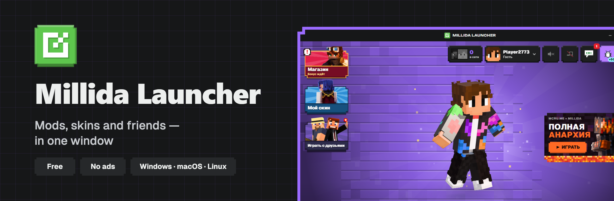
</p>

<p align="center">
  <a href="https://millida.net/launcher/dl/windows"></a>
  <a href="https://millida.net/launcher/dl/macos">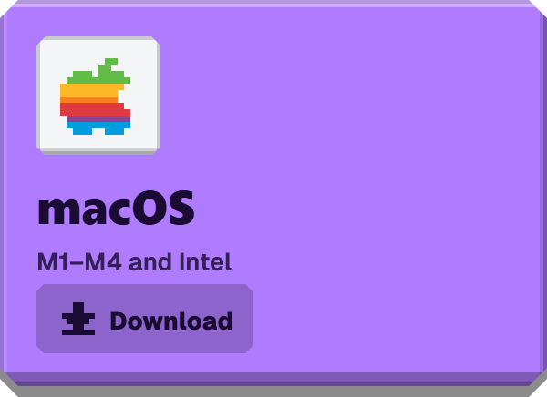</a>
  <a href="https://millida.net/launcher/dl/linux"></a>
</p>

<p align="center">
  <a href="https://github.com/millida/launcher/releases/latest"></a>
  <a href="https://millida.net/launcher/antivirus"></a>
  <a href="LICENSE"></a>
</p>

<p align="center">
  <a href="https://millida.net/launcher/antivirus">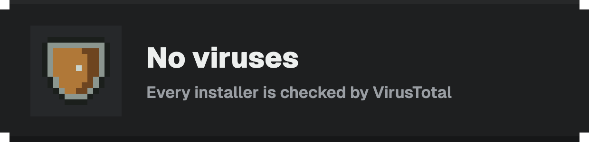</a>
  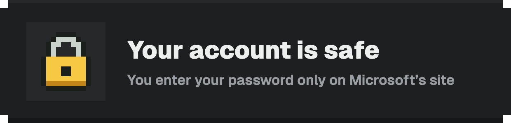
  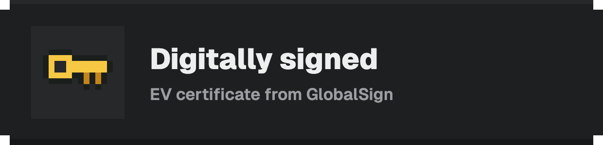
  <a href="ARCHITECTURE.md">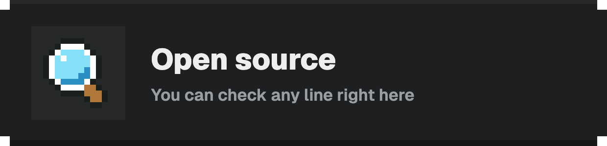</a>
</p>

<p align="center">
  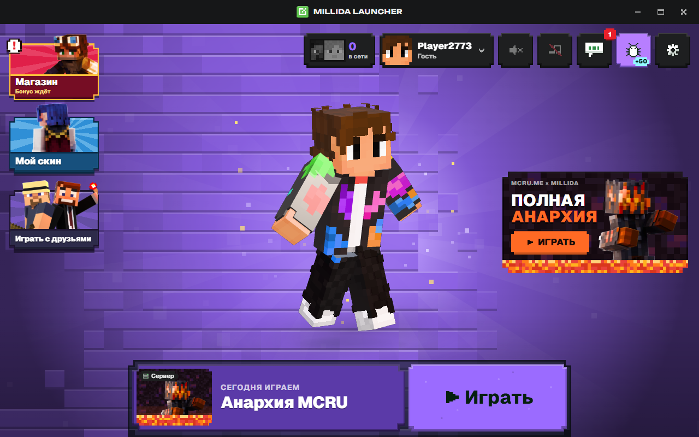
</p>

| Instances | Catalog |
| :---: | :---: |
| 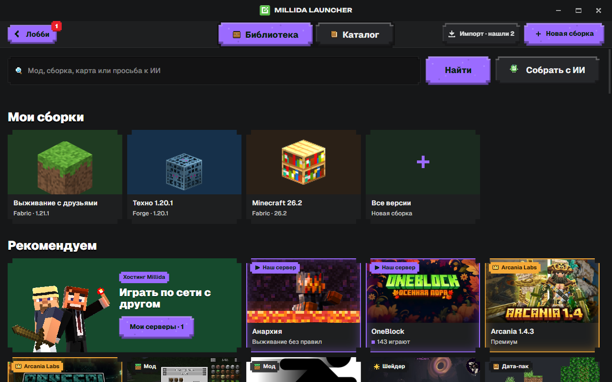 | 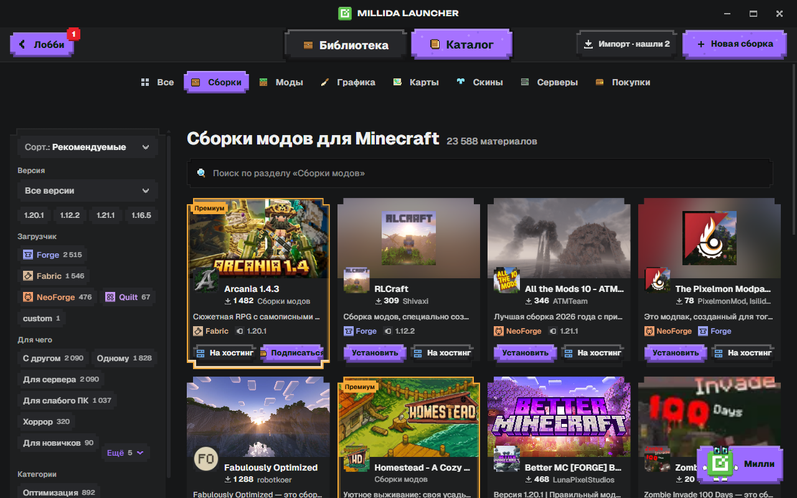 |
| **Wardrobe** | **Your own server** |
| 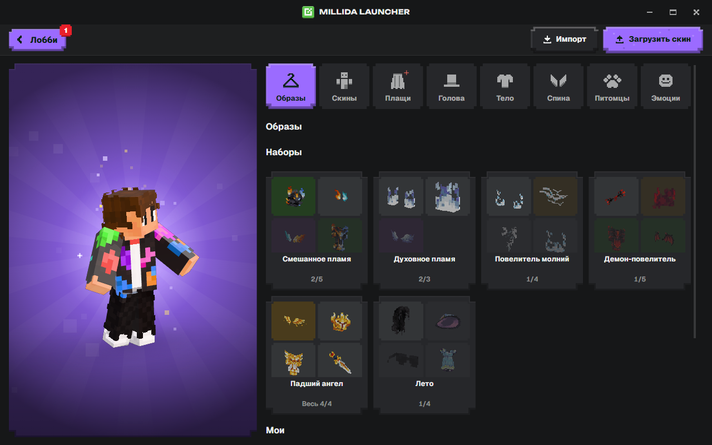 | 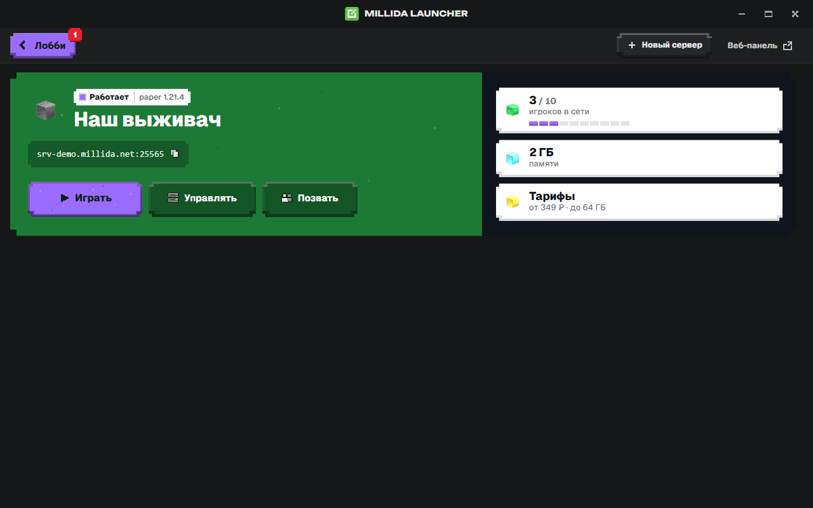 |

<p align="center">
  <a href="BUILDING.md">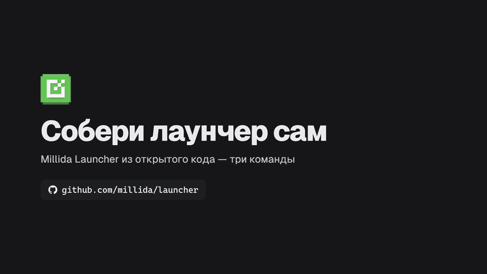</a>
</p>

*English | [Русский](#русский)*

## Install

<details>
<summary><b>Windows</b>: <code>.exe</code> installer</summary>

1. Download and run the [signed installer](https://github.com/millida/launcher/releases/download/setup-signed-1/MillidaLauncherSetup.exe). The launcher opens by itself.
2. If you see a blue window "Windows protected your PC": click **"More info"**, then **"Run anyway"**.

The launcher updates itself.
</details>

<details>
<summary><b>macOS</b>: <code>.dmg</code> image or one command</summary>

Drag **Millida Launcher** to "Applications". If macOS says the app is "damaged", run this in Terminal:

```bash
chmod -R u+w "/Applications/Millida Launcher.app" && xattr -cr "/Applications/Millida Launcher.app"
```

Or install with one command and skip that step:

```bash
curl -fsSL https://launcher-storage.millida.net/setup/install.sh | sh
```
</details>

<details>
<summary><b>Linux</b>: Flatpak or one command</summary>

```bash
flatpak install --user https://launcher-flatpak.millida.net/millida-launcher.flatpakref
```

Without Flatpak (AppImage with a menu shortcut):

```bash
curl -fsSL https://launcher-storage.millida.net/setup/install.sh | sh
```

`.deb` and `.rpm` files are on the [download page](https://millida.net/launcher#download).
</details>

## FAQ

<details>
<summary><b>Is it free?</b></summary>

Yes. There are no ads and no extra software in the installer.
</details>

<details>
<summary><b>Do I need a paid copy of Minecraft?</b></summary>

No. You can play with just a nickname. If you own the game, you sign in through the official Microsoft window. The launcher never sees your password.
</details>

<details>
<summary><b>Do I need to install Java?</b></summary>

No. The launcher downloads the right version itself.
</details>

<details>
<summary><b>My antivirus complains</b></summary>

The VirusTotal report for every installer is at [millida.net/launcher/antivirus](https://millida.net/launcher/antivirus). Download only from millida.net or from the [releases](https://github.com/millida/launcher/releases) page. Anything else is not ours.
</details>

<details>
<summary><b>Something does not work</b></summary>

Write in [Discord](https://discord.gg/mcru) or open an issue. Attach `logs/launcher-latest.log` from the instance folder to your report.
</details>

<details>
<summary><b>Why does the launcher have telemetry?</b></summary>

We want to learn about breakages before players write to support, and fix them faster. For example, on 13.10.2026 the crash events showed that some Fabric instances crash because of an old Fabric Loader. The same data shows which screens are slow and what people cannot find in the interface. When you sign in to a Millida account, the statistics are linked to it. Passwords, tokens, files and chat texts are never sent. You can turn it off in "Settings → Account → Usage statistics". The full list of what is sent and the code that sends it: [TELEMETRY.md](TELEMETRY.md).
</details>

<details>
<summary><b>How do I uninstall it?</b></summary>

Windows: "Settings" → "Apps". macOS: move it to the Trash. Flatpak: `flatpak uninstall net.millida.launcher`.
</details>

## For developers

Rust core (Tauri 2) and a React interface. License: [GPL-3.0-only](LICENSE).

[How to build it yourself](BUILDING.md) · [Architecture](ARCHITECTURE.md) · [How to send a fix](CONTRIBUTING.md) · [Vulnerabilities](SECURITY.md) · [Name and logo](TRADEMARK.md)

<details>
<summary><b>Why the code is open</b></summary>

The launcher handles your Microsoft sign-in, the game files and network requests. The honest answer to "what does it do with my account" is to let you read all of the code. From January to June 2026, fake Minecraft clients [infected more than a hundred thousand machines](https://thehackernews.com/2026/08/weedhack-malware-spreads-via-fake.html) and stole exactly the Microsoft sign-in token.

- Official builds come only from [millida.net/launcher](https://millida.net/launcher) and from the [releases](https://github.com/millida/launcher/releases) of this repository.
- We do not support third-party builds. You can still build the code for yourself.
- We accept fixes here, so every player gets them at once.
- GPL-3.0 gives you the right to fork. The brand, the keys and our services are not covered by it. See [TRADEMARK.md](TRADEMARK.md).

A fork needs its own name, its own icons and its own app registration in Azure (`MILLIDA_MS_CLIENT_ID`). Game installation, loaders, Java and Modrinth work without our servers. Millida sign-in, friends, skins, the rating, the hosting panel and the CurseForge proxy use `api.millida.net`.
</details>

<sub>Millida Launcher is not affiliated with Mojang AB or Microsoft. Minecraft is a trademark of Mojang AB.</sub>

---

## Русский

<p align="center">
  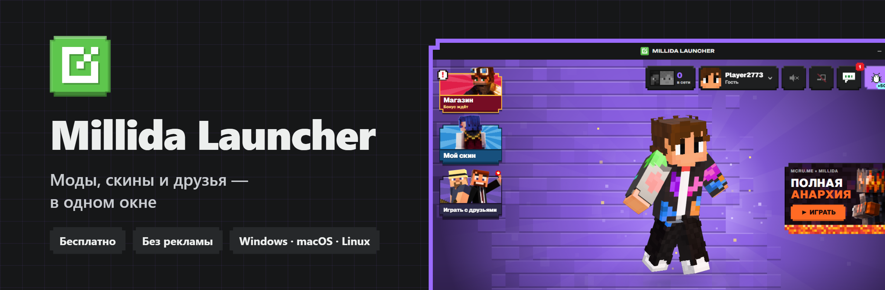
</p>

<p align="center">
  <a href="https://millida.net/launcher/dl/windows">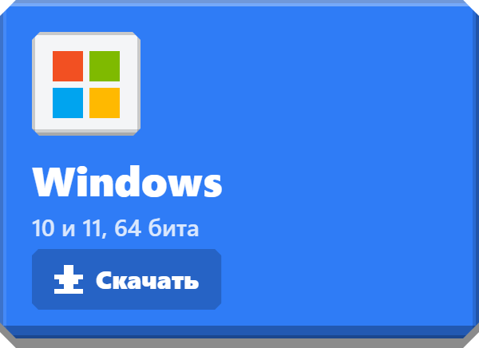</a>
  <a href="https://millida.net/launcher/dl/macos">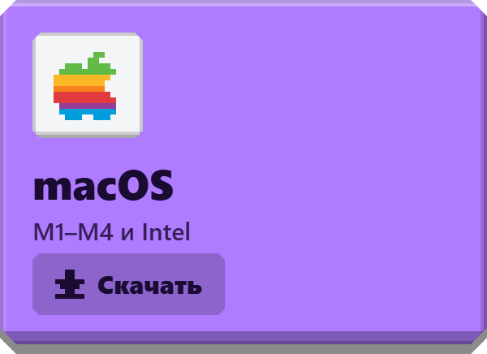</a>
  <a href="https://millida.net/launcher/dl/linux">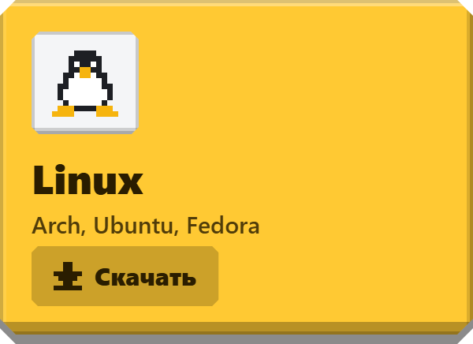</a>
</p>

<p align="center">
  <a href="https://github.com/millida/launcher/releases/latest"></a>
  <a href="https://millida.net/launcher/antivirus"></a>
  <a href="LICENSE"></a>
</p>

<p align="center">
  <a href="https://millida.net/launcher/antivirus">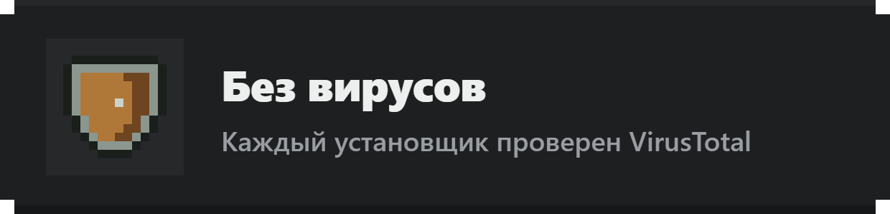</a>
  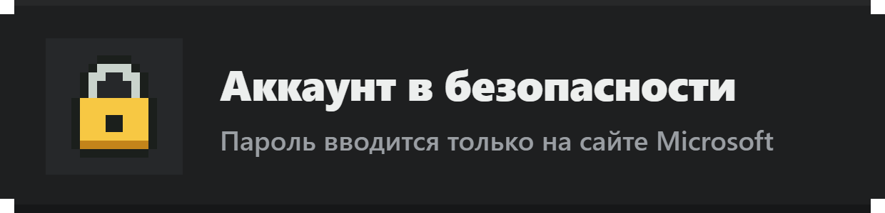
  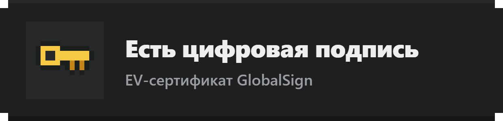
  <a href="ARCHITECTURE.md">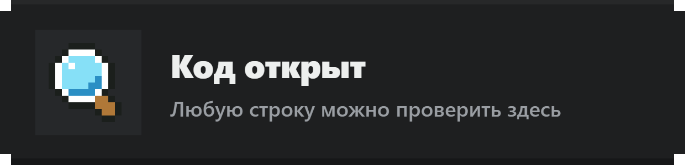</a>
</p>

<p align="center">
  
</p>

| Сборки | Каталог |
| :---: | :---: |
|  |  |
| **Гардероб** | **Свой сервер** |
|  |  |

<p align="center">
  <a href="BUILDING.md"></a>
</p>

## Установка

<details>
<summary><b>Windows</b> — установщик <code>.exe</code></summary>

1. Скачай и запусти [установщик с подписью](https://github.com/millida/launcher/releases/download/setup-signed-1/MillidaLauncherSetup.exe) — лаунчер откроется сам.
2. Если появилось синее окно «Windows защитила ваш компьютер»: **«Подробнее»** → **«Выполнить в любом случае»**.

Обновления лаунчер ставит сам.
</details>

<details>
<summary><b>macOS</b> — образ <code>.dmg</code> или одна команда</summary>

Перетащи **Millida Launcher** в «Программы». Пишет «повреждено» — выполни в Терминале:

```bash
chmod -R u+w "/Applications/Millida Launcher.app" && xattr -cr "/Applications/Millida Launcher.app"
```

Или поставь одной командой, без этого шага:

```bash
curl -fsSL https://launcher-storage.millida.net/setup/install.sh | sh
```
</details>

<details>
<summary><b>Linux</b> — Flatpak или одна команда</summary>

```bash
flatpak install --user https://launcher-flatpak.millida.net/millida-launcher.flatpakref
```

Без Flatpak (AppImage с ярлыком в меню):

```bash
curl -fsSL https://launcher-storage.millida.net/setup/install.sh | sh
```

`.deb` и `.rpm` — на [странице загрузки](https://millida.net/launcher#download).
</details>

## Вопросы

<details>
<summary><b>Это бесплатно?</b></summary>

Да. Без рекламы и постороннего софта в установщике.
</details>

<details>
<summary><b>Нужен купленный Minecraft?</b></summary>

Нет: можно играть по нику. С лицензией — вход через официальное окно Microsoft, пароль лаунчер не видит.
</details>

<details>
<summary><b>Java ставить нужно?</b></summary>

Нет, лаунчер скачает подходящую сам.
</details>

<details>
<summary><b>Антивирус ругается</b></summary>

Отчёт VirusTotal по каждому установщику — на [millida.net/launcher/antivirus](https://millida.net/launcher/antivirus). Качай только с millida.net или со страницы [релизов](https://github.com/millida/launcher/releases) — всё остальное не наше.
</details>

<details>
<summary><b>Что-то не работает</b></summary>

Напиши в [Discord](https://discord.gg/mcru) или заведи issue. К отчёту приложи `logs/launcher-latest.log` из папки сборки.
</details>

<details>
<summary><b>Зачем лаунчеру телеметрия?</b></summary>

Чтобы узнавать о поломках раньше, чем о них напишут в поддержку, и чинить их быстрее. Так, например, 13.10.2026 по событиям вылета нашли, что часть сборок на Fabric падает из-за старого Fabric Loader. По ней же видно, какие экраны тормозят и что в интерфейсе не находят. При входе в аккаунт Millida статистика привязывается к нему. Пароли, токены, файлы и тексты чатов не уходят, выключается в «Настройки → Аккаунт → Статистика использования». Полный список отправляемого и код, который это делает: [TELEMETRY.md](TELEMETRY.md).
</details>

<details>
<summary><b>Как удалить?</b></summary>

Windows — «Параметры» → «Приложения»; macOS — в корзину; Flatpak — `flatpak uninstall net.millida.launcher`.
</details>

## Разработчикам

Rust-ядро (Tauri 2) и интерфейс на React, лицензия [GPL-3.0-only](LICENSE).

[Как собрать самому](BUILDING.md) · [Устройство](ARCHITECTURE.md) · [Как прислать правку](CONTRIBUTING.md) · [Уязвимости](SECURITY.md) · [Название и логотип](TRADEMARK.md)

<details>
<summary><b>Зачем открыт код</b></summary>

Лаунчер держит вход в аккаунт Microsoft, файлы игры и сетевые запросы — честный ответ на вопрос «что он делает с моим аккаунтом» — дать прочитать код целиком. С января по июнь 2026 года поддельные клиенты Minecraft [заразили больше ста тысяч машин](https://thehackernews.com/2026/08/weedhack-malware-spreads-via-fake.html) и крали именно токен входа Microsoft.

- Официальные сборки — только с [millida.net/launcher](https://millida.net/launcher) и из [релизов](https://github.com/millida/launcher/releases) этого репозитория.
- Сторонние сборки мы не поддерживаем. Собрать код для себя это не мешает.
- Правки принимаем сюда — так они достаются всем игрокам сразу.
- GPL-3.0 даёт право на форк, но бренд, ключи и наши сервисы под неё не подпадают — см. [TRADEMARK.md](TRADEMARK.md).

Форку нужны своё имя, свои иконки и своя регистрация приложения в Azure (`MILLIDA_MS_CLIENT_ID`). Установка игры, загрузчики, Java и Modrinth работают без наших серверов; вход Millida, друзья, скины, рейтинг, панель хостинга и прокси к CurseForge ходят в `api.millida.net`.
</details>

<sub>Millida Launcher не связан с Mojang AB и Microsoft. Minecraft — товарный знак Mojang AB.</sub>
