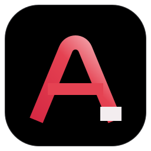

# Aera Launcher

  

<strong>By Aera Intelligence</strong>

Aera Launcher is an independently branded desktop launcher for Minecraft. This source tree is a rebrand/fork of the GPL-3.0-only Millida Launcher codebase; the upstream copyright and third-party notices remain in force.

## Current integration and release status

This change updates the product-facing Aera branding; it does **not** migrate Millida-operated infrastructure. The connected account/authentication, API, catalog, cosmetics, hosting and related service integrations remain configured to their existing endpoints. They have been preserved so existing functionality is not disconnected.

The Tauri app identifier and `millida://` deep-link scheme are also intentionally unchanged for data, session and callback compatibility. The updater endpoint, signature key and update flow still refer to the existing Millida update service. A branded Aera build must therefore **not** be advertised as an independently released or independently updating Aera distribution until Aera-owned application registration, signing key, update feed and service ownership/permissions are provisioned and migrated. No new endpoint, credential or domain is implied by this rebrand.

Until that migration is authorized and completed, use this repository as source for development/testing only. Do not install or publish a package as an official Aera release based solely on the changed display name or icons.

## Build from source

See [BUILDING.md](BUILDING.md) for the source-build prerequisites and commands. Verify the target configuration before distributing a binary; it still includes the upstream identity and update compatibility values described above.

## License and attribution

The code is distributed under [GPL-3.0-only](LICENSE). Preserve [NOTICE](NOTICE), [THIRD-PARTY.md](THIRD-PARTY.md), and the restrictions/attribution guidance in [TRADEMARK.md](TRADEMARK.md) when redistributing. Aera Launcher branding is separate from the original code copyright. Minecraft is a trademark of Mojang AB/Microsoft; this project is not affiliated with or endorsed by Mojang or Microsoft.

## Project documentation

[Architecture](ARCHITECTURE.md) · [Contributing](CONTRIBUTING.md) · [Security](SECURITY.md) · [Telemetry](TELEMETRY.md) · [Name and logo](TRADEMARK.md)
