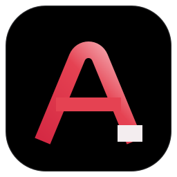

*[English version: README.md](README.md) | Русский*

# Aera Launcher

  

<strong>От Aera Intelligence</strong>

Aera Launcher — независимо брендированный настольный лаунчер Minecraft. Этот исходный код представляет собой ребрендинг/форк Millida Launcher под лицензией GPL-3.0-only; авторские права исходного проекта и уведомления о сторонних компонентах сохраняются.

## Текущие интеграции и статус выпуска

Эти изменения обновляют видимый бренд приложения, но **не** переносят инфраструктуру, которой управляет Millida. Подключённые аккаунт/авторизация, API, каталог, косметика, хостинг и связанные сервисы сохраняют прежние конечные адреса. Конфигурация не менялась, чтобы не отключать существующие функции.

Идентификатор приложения Tauri и схема глубокой ссылки `millida://` также намеренно сохранены для совместимости с данными, сессиями и обратными вызовами. Сервер обновлений, ключ подписи и процесс обновления пока связаны с существующим сервисом Millida. Поэтому сборку с брендингом Aera нельзя **представлять как независимый официальный выпуск или независимо обновляемый дистрибутив Aera**, пока не будут предоставлены и перенесены регистрация приложения Aera, ключ подписи, сервер обновлений и права на использование нужных сервисов. Ребрендинг не подразумевает наличие новых адресов, ключей или доменов.

Пока такой перенос не согласован и не выполнен, используйте этот репозиторий только для разработки и тестирования. Не устанавливайте и не публикуйте пакет как официальный выпуск Aera только на основании нового названия или иконок.

## Сборка из исходного кода

Предварительные требования и команды — в [BUILDING.md](BUILDING.md). Перед распространением проверьте конфигурацию целевой сборки: в ней намеренно оставлены значения идентификации и обновлений исходного проекта, указанные выше.

## Лицензия и атрибуция

Код распространяется по лицензии [GPL-3.0-only](LICENSE). При повторном распространении сохраняйте [NOTICE](NOTICE), [THIRD-PARTY.md](THIRD-PARTY.md) и требования к атрибуции/товарным знакам из [TRADEMARK.ru.md](TRADEMARK.ru.md). Брендинг Aera Launcher не меняет авторские права на исходный код. Minecraft — товарный знак Mojang AB/Microsoft; проект не связан с Mojang или Microsoft и не одобрен ими.

## Документация проекта

[Архитектура](ARCHITECTURE.ru.md) · [Участие в проекте](CONTRIBUTING.ru.md) · [Безопасность](SECURITY.ru.md) · [Телеметрия](TELEMETRY.ru.md) · [Название и логотип](TRADEMARK.ru.md)
